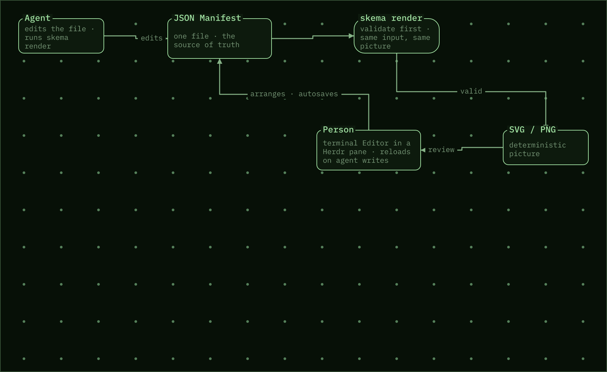

# Pallas Skema

Skema is an agent native diagramming tool that brings beautiful diagrams as editable,
shareable artifacts to your terminal with a one shot.

It speeds up comprehension, design, and iteration with your agent through visual reasoning.

### For the Agent:  
- Using a coordinate system, validation rules, an ultra fast rust package and a skill, the agents
can more effectively reason through visual space and present designs that a human can understand.
- SVG and PNG artifacts out of the box are a quick visual reference an agent can spot check independently.
- A JSON manifest saves the diagram state. Commit it to the repo, exclude it, throw it away, modify it,
ask your agent to compare. The format is easy to read and unbreakable syntactically. 

### For the Human User: 
- Point your agent at a markdown document or domain of code and just ask for a diagram.
- Edit manually in a TUI or just see the TUI for a spot check while iteratively prompting. 
- Terminal multiplexer friendly. Integrated with herdr with more to come. Ask a diagram agent to watch
another terminal "pane" and diagram out the logs. 
- Auto save and validation keeps the diagram and svg / png in sync at all times. 
- copy to clipboard convenience button lets you Diagram, copy, and share with just a prompt and a click.
- Can match your terminal theme with ANSI palettes open to further customization. 


A Skema diagram is one small JSON file: representing nodes on a grid, edges between them,
labels and descriptions. The agent edits that file and runs one command to
validate it and render an SVG. The user opens the same file in
a terminal Editor, or in a Herdr pane beside the agent, and rearranges by hand. Autosave syncs all the artifacts.




- Invalid diagrams dont render. Validation displays the broken rule and leaves
  the last good picture.
- The same manifest always produces the same SVG, so diffs are small and
  reviewable. 
- The Editor snaps to the grid, refuses moves that would overlap, and saves
  every edit at once. An agent's write shows up in the pane as it
  happens.

## Install

**1. Add the skill to your agent.** The `skema-diagram` skill teaches an agent
to create and change diagrams, when to render, and how to open the Editor pane
for you.

Claude Code, from the marketplace:

```bash
claude plugin marketplace add semper-nova-tech/pallas-skema
claude plugin install pallas-skema@pallas-skema
```

Cursor: add this repository as a plugin. It carries
`.cursor-plugin/plugin.json`, which points at the same `skills/` directory.

OpenAI Codex:

```bash
git clone https://github.com/semper-nova-tech/pallas-skema
ln -s "$PWD/pallas-skema/skills/skema-diagram" ~/.codex/skills/skema-diagram
```

**2. `skema` installs itself.** The skill needs the `skema` binary, one
prebuilt file for macOS, Linux, and Windows, with no Rust needed. On first use
the agent notices it is missing and offers to install it for you. To install it
yourself instead, on macOS or Linux:

```bash
curl --proto '=https' --tlsv1.2 -LsSf https://github.com/semper-nova-tech/pallas-skema/releases/latest/download/skema-installer.sh | sh
```

Windows (PowerShell):

```powershell
powershell -ExecutionPolicy Bypass -c "irm https://github.com/semper-nova-tech/pallas-skema/releases/latest/download/skema-installer.ps1 | iex"
```

**3. Optional: Herdr.** The Editor runs in any terminal: a second tab, a tmux
split, or Windows Terminal. In [Herdr](https://herdr.dev)
the agent can open it as a pane beside itself:

```bash
herdr plugin install semper-nova-tech/pallas-skema/herdr-plugin
```

The plugin installs `skema` for you if step 2 has not.

## Try it

```bash
# agent side: edit flow.json, then
skema render --manifest flow.json --svg flow.svg

# person side, in a second terminal (or a tmux split)
skema open-editor --manifest flow.json --svg flow.svg

# or, inside Herdr, as a pane
herdr plugin pane open --plugin pallas.skema --entrypoint editor \
  --env SKEMA_MANIFEST=$PWD/flow.json --focus
```

`examples/flow.json` is a small four-node flow to start from.

---

Reference for contributors follows. Design documents:
[product brief](pallas-skema.md), [delivery strategy](brainstorming.md),
[feature docs](docs/features/skema-v1/README.md).

## Build

From source, for contributors. Requires a Rust toolchain (`rustup`).

```bash
cargo build --release
```

The binary is `target/release/skema`. It has no runtime dependencies.

## Release

[cargo-dist](https://github.com/axodotdev/cargo-dist) builds the prebuilt
binaries (`dist-workspace.toml`, `.github/workflows/release.yml`). To cut a
release, set one version in `crates/skema/Cargo.toml` and the four plugin
manifests, commit, and push a matching tag:

```bash
git tag v0.2.1 && git push origin v0.2.1
```

CI builds macOS and Linux (arm64 and x86_64) and Windows (x86_64), publishes a
GitHub Release with `skema-installer.sh` and `skema-installer.ps1`. The
installers always fetch the latest release, so the skill's install offer picks
up a new version without any change.
`dist plan` checks the setup locally. After changing `dist-workspace.toml`, run
`dist generate` to refresh the workflow.

## Agent loop

The Manifest JSON file is the source of truth. An agent edits it, then renders.
Validation runs first. On failure the text failure goes to stderr, the exit code
is non-zero, and an existing SVG is left byte-for-byte unchanged.

```bash
skema render --manifest flow.json --svg flow.svg
skema render --manifest flow.json --svg flow.svg --png flow.png   # also a PNG
```

`skema validate --manifest flow.json` checks without writing anything. The PNG
is rasterized from the same SVG with the same embedded font, at 2 pixels per
SVG unit. `--theme phosphor|nord|terminal` overrides the remembered theme for
one render.

## Editor (terminal)

The Editor is a terminal app, like Hunk or TTT. It runs in the current
terminal, which can be a Herdr pane, and needs no browser.

```bash
skema open-editor --manifest flow.json --svg flow.svg
```

- A missing Manifest starts an empty Diagram.
- Nodes sit on Grid cells. Arrows move the selected Node one whole cell at a
  time, or drag it with the mouse. A move that would overlap another Node or
  leave the Grid is refused with the Validation text.
- Edges leave and enter at the middle of a side of each Node. Dragging from a
  connection handle fixes the side it leaves by, and the side you drop on is
  where it enters; those sides are saved in the Manifest. Edges made without a
  handle use the side that faces the other Node. An Edge that leaves and
  enters by the same side steps half a cell out, like a bracket.
- Canvas, above Settings, fixes the canvas size: 16×10 or 24×15 landscape
  (▭), 10×16 or 15×24 portrait (▯). The choice is saved in the Manifest as
  `canvas` and the SVG takes that size. A size that would leave a Node outside
  is dim and refused, and with a canvas set, a move past its edge is refused.
- Every Node shares one color and the type is not drawn; decisions have rounded
  corners. The selected Node is drawn filled; others are outlined. A Node has a
  `label` and an optional `description`.
- When an agent writes the Manifest, a clean Editor reloads it on the spot. An
  Editor with unsaved edits keeps them and shows a warning; `r` reloads.
- Every accepted edit is saved at once: the Manifest is written, then the SVG
  is rendered. An edit that fails Validation is refused and writes nothing, so
  the files on disk are always valid. `s` forces a save. Pass `--manual-save`
  to write only on `s`. `q` saves before quitting; only a Diagram that fails
  Validation stays open, and a second `q` discards it.
- Settings, under the buttons, picks the theme: Phosphor (the original green),
  Nord, or Match terminal, which uses the terminal's own ANSI colors so
  Ghostty's theme shows through. `T` cycles. The choice is kept in
  `~/.config/skema/theme`, and the SVG and PNG follow it: the Editor
  re-renders on a switch, Copy image uses it, and `skema render` reads the
  same setting so an agent's render matches. For Match terminal the Editor
  asks the terminal for its real colors (OSC 10, 11, and 4) and caches them in
  `~/.config/skema/terminal-palette.json` for those exports.
- The Copy image button, or `y`, puts a PNG of the Diagram on the system
  clipboard as a picture, ready to paste into chat or a document (AppleScript
  on macOS, `wl-copy` or `xclip` on Linux). `Y` copies the SVG markup as text.

Keys: `tab` and `shift+tab` cycle through Nodes and then Edges, arrows move the
selected Node, `enter` (or a double-click) opens it for editing, `a` add,
`c` connect (press on the source, then click the target or tab to it and press `c` again), `x` delete,
`+` `-` zoom, `0` fit to pane, `y` copy image, `Y` copy SVG text, `s` force a save, `r` reload, `q` quit.

In the Node editor, up and down pick a field (label, description, size),
`enter` edits it (size cycles), `enter` again saves the field, and `esc` steps
back out. Every field change goes through Validation like a move. The Node
type stays in the Manifest for agents and is not shown in the Editor.

Zooming out stops at the level where the whole Diagram fits the pane, decided
by whichever of width or height runs out first. The mouse wheel scrolls the
canvas (shift for sideways); the view follows the selection again as soon as
it changes.

The SVG and the terminal view share one drawing rule set: Edges leave and
enter at side midpoints, run orthogonally with an arrowhead at the target, a
second Edge into a side takes the next-best side, labels ride the top edge,
and descriptions fill the box.

## Herdr pane

`herdr-plugin/` opens the Editor as a Herdr pane next to the agent:

```bash
herdr plugin link /path/to/pallas-skema/herdr-plugin
herdr plugin pane open --plugin pallas.skema --entrypoint editor \
  --env SKEMA_MANIFEST=/abs/path/flow.json --focus
```

## Agent plugins

`skills/skema-diagram/SKILL.md` teaches an agent the edit, render, and
open-the-pane loop. It follows the agent skills format, so one file serves both:

- **Claude Code:** this repository is a plugin (`.claude-plugin/plugin.json`).
  Add it as a marketplace from the repo path or URL, or symlink
  `skills/skema-diagram` into `~/.claude/skills/`.
- **OpenAI Codex:** symlink or copy `skills/skema-diagram` into
  `~/.codex/skills/`.

## Legacy web editor

`skema-editor/` holds the earlier Angular editor. It is no longer served by the
CLI and is kept for reference only.
