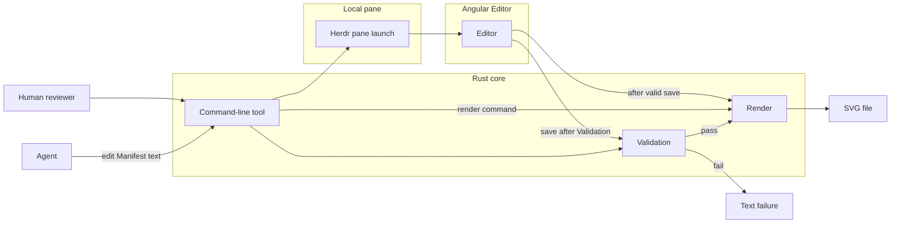
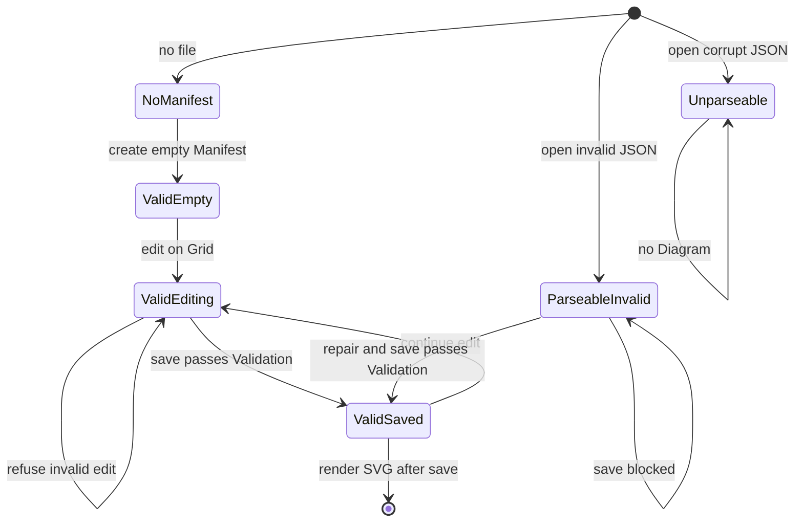

# Architecture overview: Pallas Skema v1
Status: planned

## Today → After

- **Today:** The repository is documentation only. There is no validator, SVG renderer, command-line tool, Editor, or checked-in Manifest (Discovery index DISC-index v1 at `848e096e`).
- **After:** A Rust command-line tool owns Validation and Render on local Manifest and SVG files. The same Validation outcome gates every SVG write for the Agent path and the Editor save path. An Angular Editor opens from the command-line tool in a Herdr pane, accepts a JSON Manifest handoff, and persists only valid Manifests. The Human reviewer gets SVG after a valid Editor save; the Agent gets SVG by invoking Render without the Editor.

## Manifest (model)

- **Fields:** Top-level `nodes` and `edges` arrays. Each Node has stable `id`, `label`, `type`, `size`, and `gridPosition` with integer `x` and `y`. Each Edge has `from` and `to` Node ids and optional `label`.
- **Invariants:** JSON parses; Node ids unique; Edge endpoints reference existing Node ids; Node `type` ∈ {process, decision, note}; Node `size` ∈ {small, medium, large}; Grid coordinates are non-negative integers with no upper bound; at most one Node per Grid cell (overlap rejected).

## Validation (contract)

- **Owner:** Backend
- **Input:** Manifest JSON text (file path or buffer)
- **Output:** Success, or Text failure naming the violated rule and Manifest location when known
- **Side effects:** None on SVG; does not execute Manifest content

## Render (contract)

- **Owner:** Backend
- **Input:** Manifest that has passed Validation (same rules as Validation contract)
- **Output:** SVG bytes written to the requested path
- **Invariants:** Same valid Manifest → identical SVG bytes; no execution of Manifest content

## Editor launch (contract)

- **Owner:** Infrastructure (local pane only)
- **Input:** JSON Manifest (initial or empty template), workspace paths for Manifest and SVG
- **Behavior:** Command-line tool opens one Angular Editor in a Herdr pane with the JSON handoff (Decision JSON handoff D-004). No hosted webpage or upload (Decision Webpage later D-005).

## Editor persistence (contract)

- **Owner:** Frontend
- **Input:** In-memory Diagram edits
- **Output:** Manifest file write only after Validation passes; Text failure on refusal or repair states
- **After valid save:** Primary journey invokes the shared Render (same backend entry as Agent) so SVG reflects the saved Manifest

## System flow

Cross-system paths for Validation, Render, and Editor launch.

## Editor Manifest states

Save and repair behavior for valid, invalid, and unparseable Manifests.

