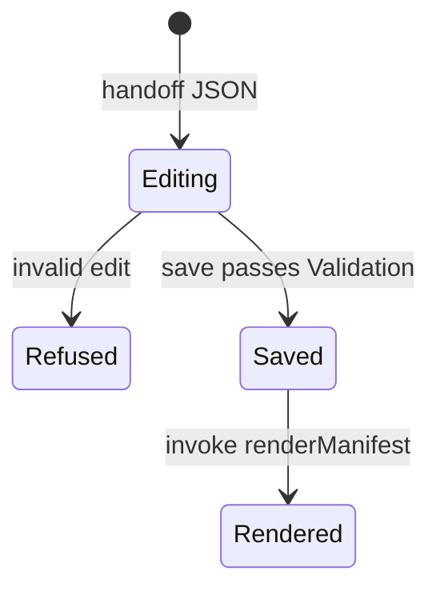

# Implement Angular Editor
Status: planned

Before: no Editor client; CLI can supply JSON handoff only.
After: Angular Editor loads handoff JSON, enforces lifecycle states, refuses invalid edits, repairs parseable invalid Manifests, and triggers shared Render after valid save.
See it: run `skema open-editor --handoff-out skema-editor/public/handoff.json …`, start `pnpm start:bridge` and `pnpm start` in `skema-editor`, open the dev server; move Nodes on Grid, save, confirm Manifest and SVG update.
Files: `skema-editor/` Angular application and `src/editor/` glossary module.
Checks: `pnpm test` and `pnpm test:integration` in `skema-editor` — pass.

## Slice

[Editor persistence (contract)](../architecture-overview.md#editor-persistence-contract) and [Editor Manifest states](../architecture-overview.md#editor-manifest-states).

## Glossary rows

Editor (owned); Diagram, Human reviewer (implemented personas).

## Nominal flow

## Requirements

STATE-editor-manifest-lifecycle, BEHAVIOR-editor-save-render, BEHAVIOR-editor-roundtrip, BEHAVIOR-refuse-invalid-edit, BEHAVIOR-empty-start, BEHAVIOR-repair-invalid.

## PT-002

Editor→Rust `validateManifest` and `renderManifest` use the existing `skema` CLI binary only (spawned by `skema-editor/server/skema-bridge.mjs` during local dev). The Angular client does not reimplement Validation or Render in TypeScript, WASM, or FFI. PR-04 pane hosting reuses the same bridge contract.
